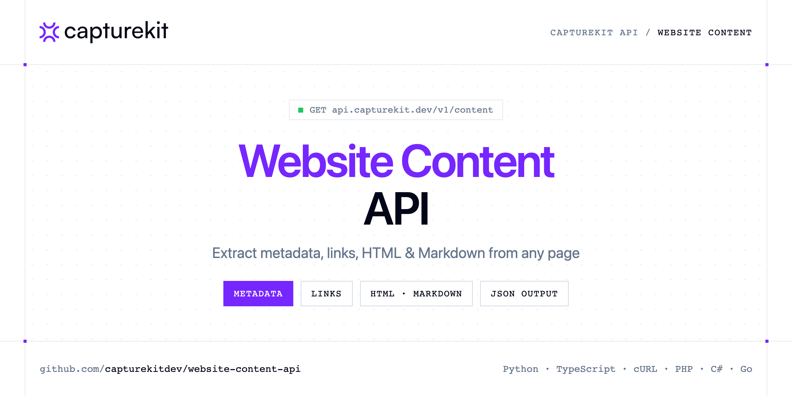

<p align="center">
  <a href="https://www.capturekit.dev"></a>
</p>

# Website Content API

[](https://discord.gg/CFj3ph8aHU) [](https://app.capturekit.dev/register) [](https://app.capturekit.dev/openapi) [](LICENSE)

The **CaptureKit Content API** loads a page in a real browser and returns its structured content: metadata, links and optionally HTML, Markdown and sitemap.

- **Content API** — CaptureKit Content API extracts structured webpage data, metadata, links, HTML/Markdown: in one request for SEO, monitoring, indexing and automation.

Use it for SEO audits, indexing, RAG pipelines (Markdown for LLMs) and monitoring.

| Endpoint | Request | Credits |
|---|---|---|
| [Content API](#content-api) | `GET /v1/content` | 1 |

## Table of contents

- [How it works](#how-it-works)
- [Content API](#content-api)
- [Code examples in other languages](#code-examples-in-other-languages)
- [Use cases](#use-cases)
- [Why CaptureKit?](#why-capturekit)
- [FAQ](#faq)
- [Related repositories](#related-repositories)
- [Support](#support)

## How it works

1. **Create a CaptureKit account** and copy your API key from the [dashboard](https://app.capturekit.dev/register).
2. **Call `https://api.capturekit.dev`** with the header `x-api-key: YOUR_API_KEY`.
3. **Use the result** in your app — no infrastructure to run.

```bash
export CAPTUREKIT_API_KEY="your-api-key"
pip install requests        # Python
# TypeScript: Node.js 18+ (native fetch), run with `npx tsx file.ts`
```

## Content API

CaptureKit Content API extracts structured webpage data, metadata, links, HTML/Markdown: in one request for SEO, monitoring, indexing and automation.

`GET https://api.capturekit.dev/v1/content` · **1 credit per request** · [API reference](https://app.capturekit.dev/openapi)

### Request parameters

| Parameter | In | Type | Required | Description |
|---|---|---|---|---|
| `url` | query | string | ✅ | The URL of the webpage to capture. |
| `include_html` | query | boolean | — | Include the raw HTML of the webpage in the response. |
| `include_markdown` | query | boolean | — | Include the Markdown of the webpage in the response. |
| `include_sitemap` | query | boolean | — | Include the sitemap of the website in the response. |
| `use_defuddle` | query | boolean | — | Use Defuddle to clean and extract the main content from web pages. This popular library removes unnecessary elements like comments, sidebars, headers, footers, and other non-essential elements, leaving only the primary c… |
| `remove_selectors` | query | string | — | A comma-separated list of elements to hide before capturing (e.g., ads, popups). |
| `remove_cookie_banners` | query | boolean | — | Automatically remove cookie banners before capturing. |
| `remove_ads` | query | boolean | — | Automatically remove ads before capturing. |
| `block_resources` | query | string (`document`, `eventsource`, `fetch`, `font`, `image`, `manifest`) | — | Comma-separated list of resource types to block (e.g., “image,stylesheet,font”). |
| `block_urls` | query | string | — | Comma-separated list of URL patterns to block (e.g., “analytics,tracking,advertisement”). |
| `delay` | query | number | — | Delay in seconds before capturing the screenshot. |
| `wait_until` | query | array (`domcontentloaded`, `load`, `networkidle0`, `networkidle2`) | — | Define when to capture. |
| `wait_for_selector` | query | string | — | Wait for a specific element to appear before taking the screenshot. |
| `proxy` | query | string | — | Specify a proxy server to route your request through. |
| `cache` | query | boolean | — | Cache the response. |
| `cache_ttl` | query | number | — | Cache the response for a custom TTL (in seconds). |

### Python example

```python
import os

import requests

API_KEY = os.environ["CAPTUREKIT_API_KEY"]
HEADERS = {"x-api-key": API_KEY}

response = requests.get(
    "https://api.capturekit.dev/v1/content",
    headers=HEADERS,
    params={
        "url": "https://github.com/seaweedfs/seaweedfs",
        "include_markdown": "true",
    },
    timeout=120,
)
response.raise_for_status()

data = response.json()
print(data)
```

### TypeScript example

```typescript
type ContentApi = {
  data?: {
    links?: {
      social?: string[];
      external?: string[];
      internal?: string[];
    };
    metadata?: {
      title?: string;
      favicon?: string;
      ogImage?: string;
      description?: string;
    };
  };
  success?: boolean;
};

const headers = { "x-api-key": process.env.CAPTUREKIT_API_KEY!, "Content-Type": "application/json" };

const params = new URLSearchParams({
  "url": "https://github.com/seaweedfs/seaweedfs",
  "include_markdown": "true",
});

const response = await fetch(`https://api.capturekit.dev/v1/content?${params}`, { headers });
if (!response.ok) throw new Error(`HTTP ${response.status}: ${await response.text()}`);

const data = (await response.json()) as ContentApi;
console.log(data);
```

### Output example

Example response from the API reference, abridged.

```json
{
  "data": {
    "links": {
      "social": [
        "https://twitter.com/capturekitdev",
        "https://linkedin.com/company/capturekit-dev"
      ],
      "external": [
        "https://docs.capturekit.dev",
        "https://www.uneed.best/tool/capture-kit"
      ],
      "internal": [
        "https://capturekit.dev/",
        "https://capturekit.dev/page-content"
      ]
    },
    "metadata": {
      "title": "Screenshot API to scale your applications",
      "favicon": "",
      "ogImage": "https://capturekit-assets.s3.amazonaws.com/capturekit-og+(1).png",
      "description": "CaptureKit is a Screenshot API for automating website screenshots. Get 100 free credits to test it and see how it fits your use case."
    }
  },
  "success": true
}
```

### Response fields

| Field | Type | Description |
|---|---|---|
| `data` | object |  |
| `data.links` | object |  |
| `data.metadata` | object |  |
| `success` | boolean |  |

## Code examples in other languages

Ready-to-run examples live in [`examples/`](examples); each reads your key from `CAPTUREKIT_API_KEY`.

| Language | `content` |
|---|---|
| cURL (Bash) | [content.sh](examples/curl/content.sh) |
| PHP | [content.php](examples/php/content.php) |
| C# | [Content.cs](examples/csharp/Content.cs) |
| Go | [content.go](examples/go/content.go) |
| Java | [ContentExample.java](examples/java/ContentExample.java) |
| Ruby | [content.rb](examples/ruby/content.rb) |
| Node.js | [content.mjs](examples/nodejs/content.mjs) |

## Use cases

- **RAG & LLM pipelines** — Get clean Markdown of any page.
- **SEO audits** — Extract titles, descriptions and links at scale.

## Why CaptureKit?

- **Screenshots as a service** — the response body *is* the image or PDF; save it or upload it straight to your S3 bucket.
- **Pixel-perfect options** — full page, viewport size, scale factor, element `selector`, 18 mobile/tablet devices, delays and wait conditions.
- **Clean pages** — remove cookie banners, ads and any CSS selector before capturing.
- **Beyond screenshots** — extract content (metadata, links, HTML, Markdown) or get an AI analysis of any page.
- **Copy-paste examples** — Python and TypeScript in each README, 7 more languages in `examples/`.

## FAQ

### How do I authenticate?

Create an account on [CaptureKit](https://app.capturekit.dev/register), copy your API key and send it in the `x-api-key` header of every request to `https://api.capturekit.dev`.

### How much does a request cost?

Credits per call: `/v1/content` **1**. See [CaptureKit pricing](https://www.capturekit.dev/pricing).

### Which languages are supported?

Any language that can make an HTTP request. This README shows Python and TypeScript; the [`examples/`](examples) folder contains cURL, PHP, C#, Go, Java, Ruby and Node.js.

## Related repositories

- [Screenshot API](https://github.com/capturekitdev/screenshot-api)
- [Full Page Screenshot API](https://github.com/capturekitdev/full-page-screenshot-api)
- [Website to PDF API](https://github.com/capturekitdev/website-to-pdf-api)
- [Mobile Screenshot API](https://github.com/capturekitdev/mobile-screenshot-api)
- [AI Website Analyzer API](https://github.com/capturekitdev/ai-website-analyzer-api)
- [Website Crawler API](https://github.com/capturekitdev/website-crawler-api)
- [All CaptureKit repositories](https://github.com/capturekitdev)

## Support

- 💬 Join the [Discord](https://discord.gg/CFj3ph8aHU) to ask questions and share what you build.
- 📚 Read the [API reference](https://app.capturekit.dev/openapi).
- 🔑 [Get your API key](https://app.capturekit.dev/register).

---

<p align="center">
  <a href="https://www.capturekit.dev">
    <picture>
      <source media="(prefers-color-scheme: dark)" srcset="images/logo-dark.svg">
      
    </picture>
  </a>
  <br>
  <sub>Built by <a href="https://www.capturekit.dev">CaptureKit</a>. Examples are released under the MIT license.</sub>
</p>
